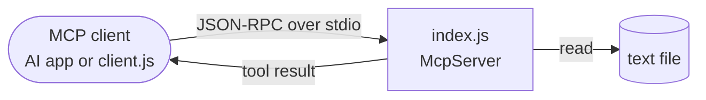

# MCP Keyword Search Server: High-Level Design

A minimal [Model Context Protocol](https://modelcontextprotocol.io) server in Node.js that exposes one tool, `keyword-search`, which returns the lines of a text file containing a keyword. It includes a demo client. For code-level detail see the [Low-Level Design](lld.md).

## 1. Context

## 2. Components

| Component | Responsibility |
|---|---|
| `index.js` | Creates `McpServer` "keyword-search-server" 1.0.0, registers the tool, connects a stdio transport |
| `client.js` | Starts the server as a child process, sends one `tools/call` request, pretty-prints the result with chalk |
| `sample.txt` | Example file to search |

## 3. Tech

| Item | Choice |
|---|---|
| Runtime | Node.js (ES modules) |
| Protocol | `@modelcontextprotocol/sdk` with stdio transport |
| Validation | zod schemas for tool arguments |
| Output styling | chalk (demo client only) |
