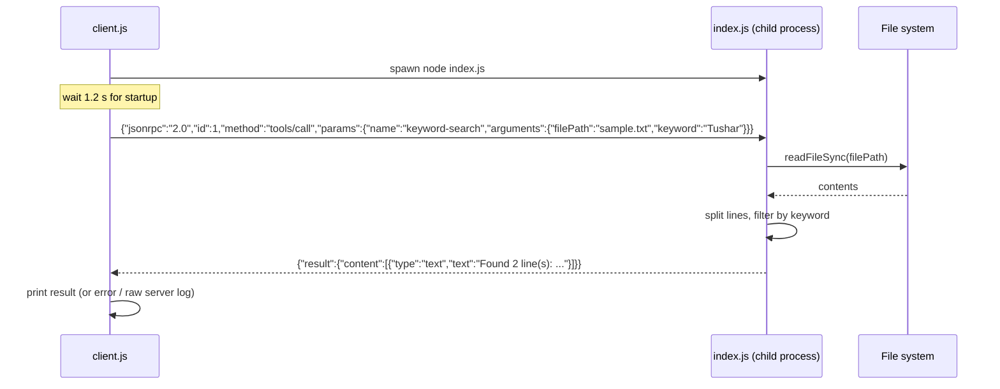

# MCP Keyword Search Server: Low-Level Design

For the big picture see the [High-Level Design](hld.md).

## 1. Tool contract

| Field | Value |
|---|---|
| Name | `keyword-search` |
| Description | Search for a keyword within a text file |
| Input | `filePath: string`, `keyword: string` (zod) |
| Output (found) | text: `Found N line(s):` followed by the matching lines |
| Output (none) | text: `No lines found containing '<keyword>'.` |
| Output (error) | text: `Error reading file: <message>`, `isError: true` |

Matching is a case-sensitive substring test on each line (`line.includes(keyword)`).

## 2. Request / response



## 3. Run

```bash
npm install
node client.js      # demo
node index.js       # as a server for any MCP client
```
